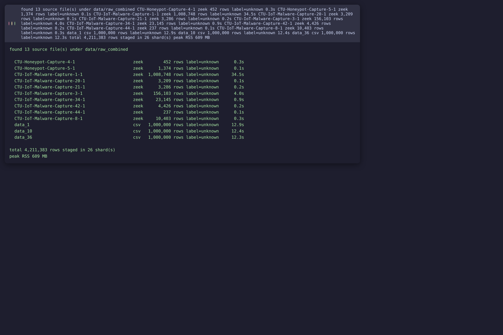
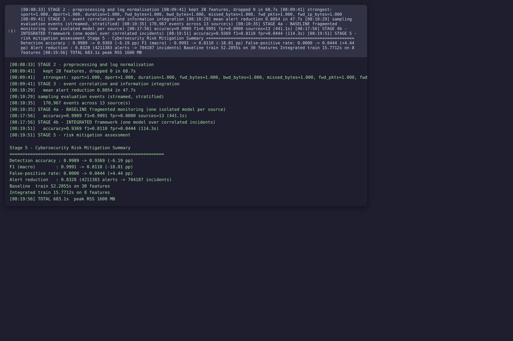
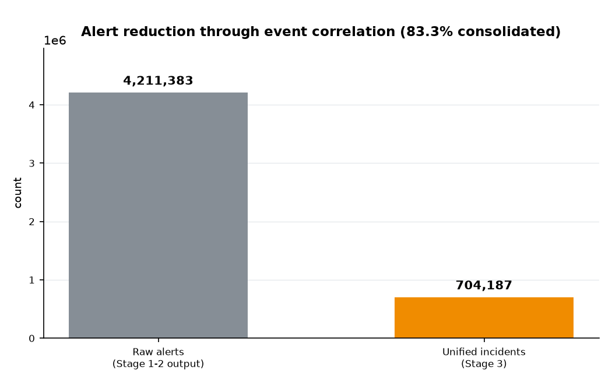
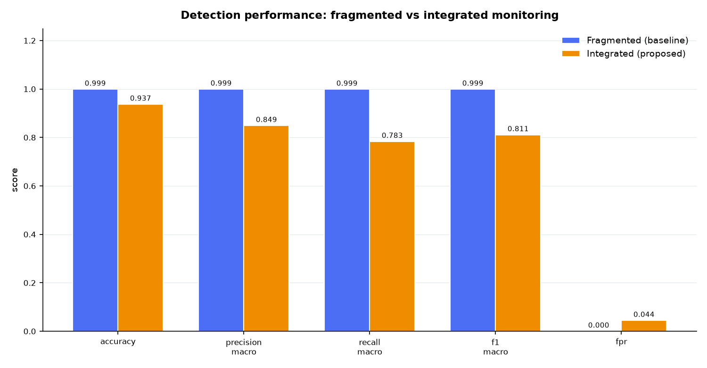
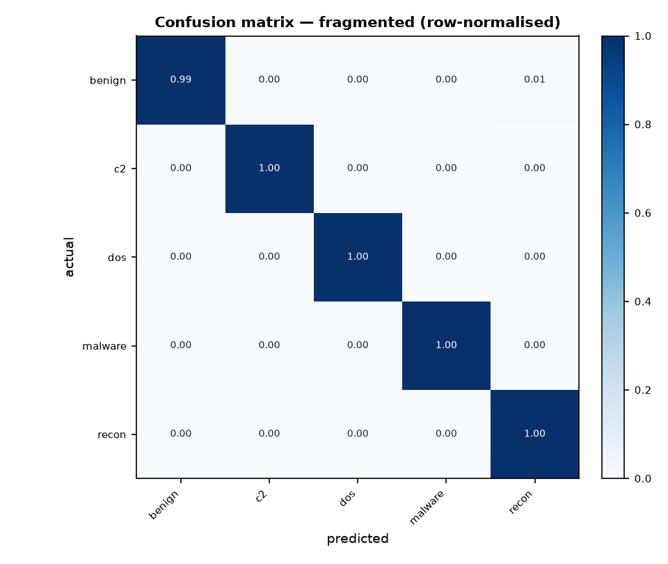
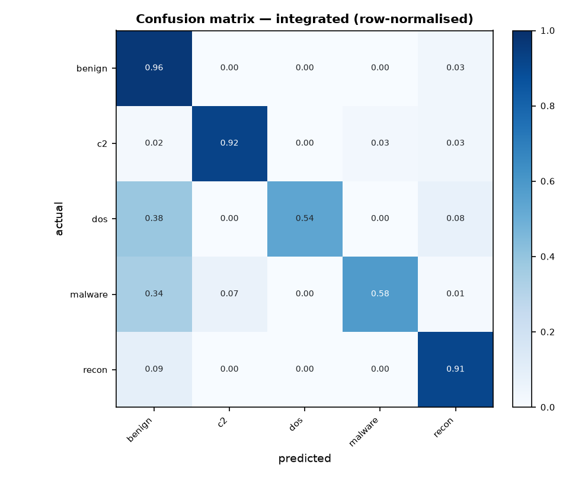
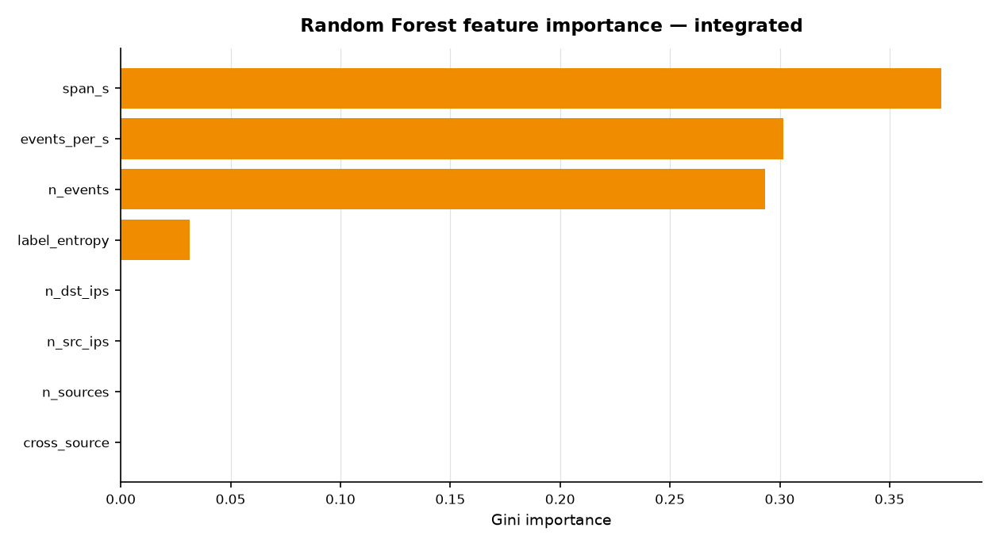

# Integrated Information Management for Cybersecurity Risk Mitigation
## Experimental Results — IoT-Enabled Smart Home Networks

*Generated 2026-10-06 05:20 UTC by `pipeline.reporting` — all figures rendered from run artefacts.*

## 1. Methodology Recap

Two monitoring conditions were evaluated on identical data. The
**fragmented baseline** processes each source in isolation with no
integration or correlation. The **integrated framework** collects logs
from multiple sources, normalises them into a unified structure, and
correlates events across sources before threat detection. Both use an
identical Random Forest classifier and identical evaluation metrics.

## 2. Results

| Metric | Fragmented (baseline) | Integrated (proposed) | Improvement |
|---|---|---|---|
| accuracy | 0.9989 | 0.9369 |  (-6.19 pp) |
| precision macro | 0.9994 | 0.8488 |  (-15.06 pp) |
| recall macro | 0.9988 | 0.7835 |  (-21.53 pp) |
| f1 macro | 0.9991 | 0.8110 |  (-18.81 pp) |
| fpr | 0.0000 | 0.0444 |  (-4.44 pp) |

## 3. Alert Consolidation

Cross-source event correlation consolidated **4,211,383**
raw alerts into **704,187** unified incidents — a
**83.3% reduction**, with a mean of
6.0 alerts per incident.
0 incidents spanned more than one
data source, which the baseline model cannot observe at all.

## 4. Comparative Performance

### Per-source baseline performance

| Source | Accuracy | F1 | FPR | Train rows |
|---|---|---|---|---|
| CTU-Honeypot-Capture-4-1 | 1.0000 | 0.0000 | 0.0000 | 0 |
| CTU-Honeypot-Capture-5-1 | 1.0000 | 0.0000 | 0.0000 | 0 |
| CTU-IoT-Malware-Capture-1-1 | 0.9950 | 0.6634 | 0.0001 | 90,006 |
| CTU-IoT-Malware-Capture-20-1 | 1.0000 | 1.0000 | 0.0000 | 2,406 |
| CTU-IoT-Malware-Capture-21-1 | 1.0000 | 1.0000 | 0.0000 | 2,464 |
| CTU-IoT-Malware-Capture-3-1 | 0.9999 | 0.7498 | 0.0001 | 52,879 |
| CTU-IoT-Malware-Capture-34-1 | 0.9998 | 0.9955 | 0.0002 | 17,358 |
| CTU-IoT-Malware-Capture-42-1 | 0.9991 | 0.8998 | 0.0000 | 3,319 |
| CTU-IoT-Malware-Capture-44-1 | 1.0000 | 1.0000 | 0.0000 | 177 |
| CTU-IoT-Malware-Capture-8-1 | 0.9996 | 0.9994 | 0.0000 | 7,802 |
| data_1 | 1.0000 | 1.0000 | 0.0000 | 46,494 |
| data_10 | 1.0000 | 1.0000 | 0.0000 | 45,022 |
| data_36 | 1.0000 | 1.0000 | 0.0000 | 45,023 |

## 5. Cross-Validation

Stratified 5-fold cross-validation, macro F1. Baseline **0.9323 ± 0.0775** (test-set-weighted pool across 11 per-source models), integrated **0.8210 ± 0.0190**.

## 6. Interpretation

Figures above are generated from the **real public datasets** named in
section 3.3 - IoT-23 (CTU Honeypot/Malware scenarios, Zeek
``conn.log.labeled``) and, where included, the Bot-IoT flow tables -
using each dataset's own analyst-assigned labels as ground truth.

### Methodological caveats (stated up front)

- **Evaluated threat classes.** Both conditions score the same
  harmonised label vocabulary: ``benign``, ``c2``, ``dos``, ``malware``, ``recon``. Vendor labels are mapped to it at ingest, so the ``DDoS``
  scenarios named in section 3.3 (Bot-IoT ``data_36``, category
  *DDoS*; IoT-23 detailed label *DDoS*) are folded into the single
  ``dos`` class rather than modelled separately. Distinguishing
  distributed from single-source flooding needs rate and entropy
  features outside this feature plan. The ``dos`` class therefore
  covers both DoS and DDoS ground truth, and every metric below
  spans both.
- **Within-capture evaluation.** Each fragmented source model is trained
  and tested on flows from the same capture, which shares temporal
  context and hosts. Near-perfect per-source accuracy reflects how
  separable IoT-23 flow features are (consistent with published
  results), but it should not be read as field performance.
- **Single-class sources.** Benign captures contain only benign flows,
  so their fragmented models trivially score 1.0 accuracy with zero
  F1 - they cannot recognise attacks they never saw. That *is* the
  fragmented-monitoring limitation the proposed framework addresses.
- **Alert reduction** is measured over the full Stage 3 event stream,
  not the evaluation sample.
- **Units of analysis.** Fragmented metrics are computed at event
  level; integrated metrics at incident level, the unit its model
  operates on. The ``event_propagation`` block in the JSON records how
  incident decisions agree with their member events - a consistency
  measure, not a held-out detection score.
- **Cross-source correlation.** Correlation is time-windowed, and the
  offline captures were recorded months apart, so no incident spans
  two sources here. Live deployment with simultaneous feeds is where
  cross-source consolidation materialises.

---

Artefacts: `results/stage5_report.json`, `results/baseline_vs_integrated.csv`, `models/rf_fragmented.joblib`, `models/rf_integrated.joblib`