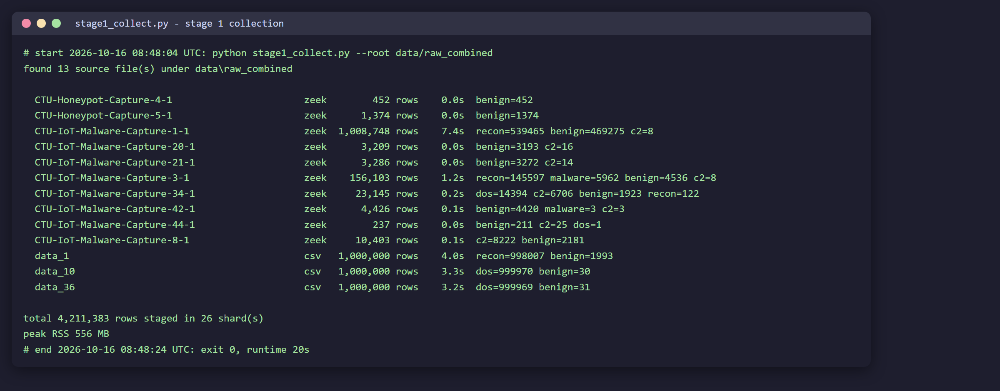
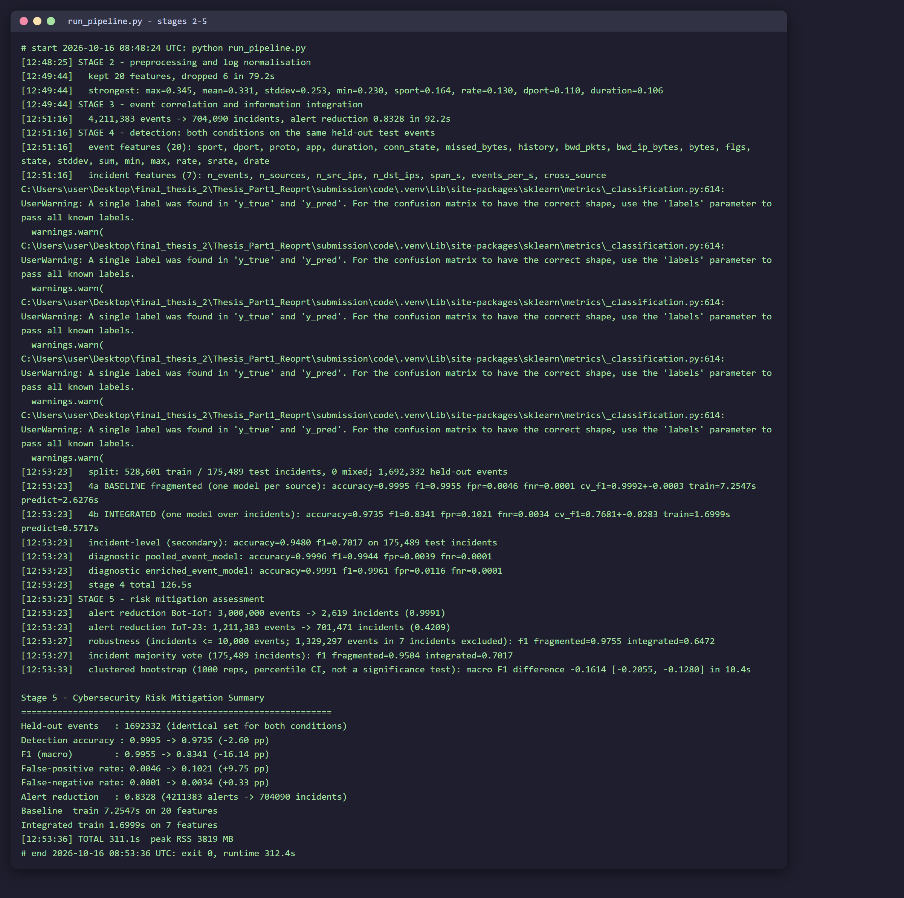
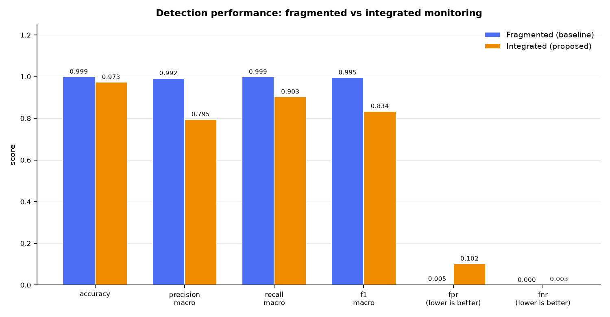
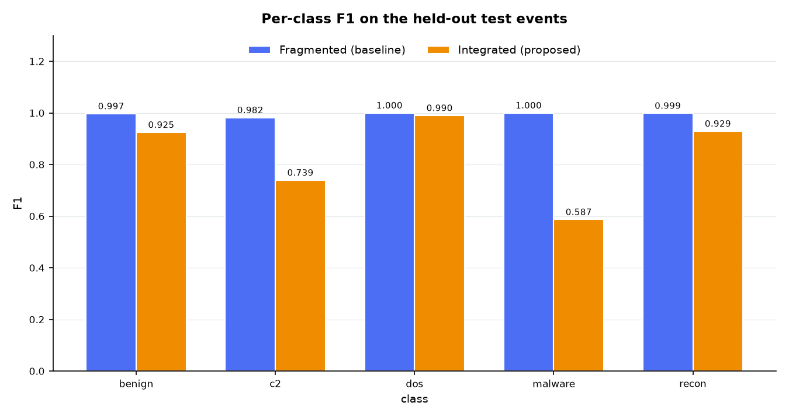
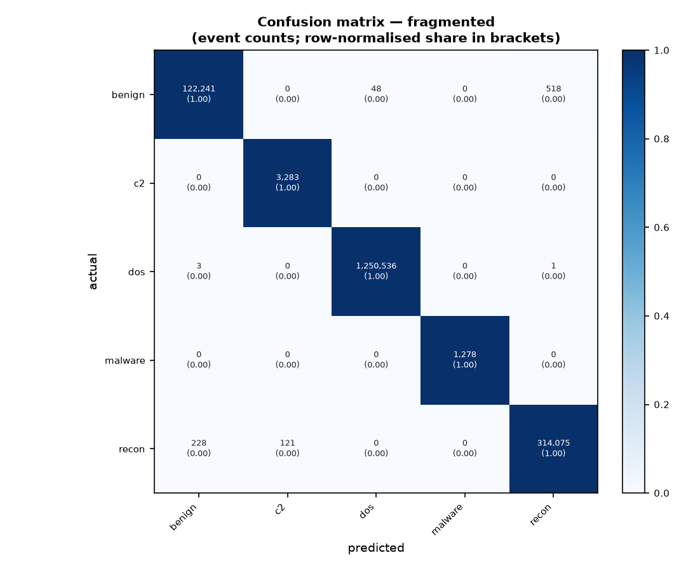
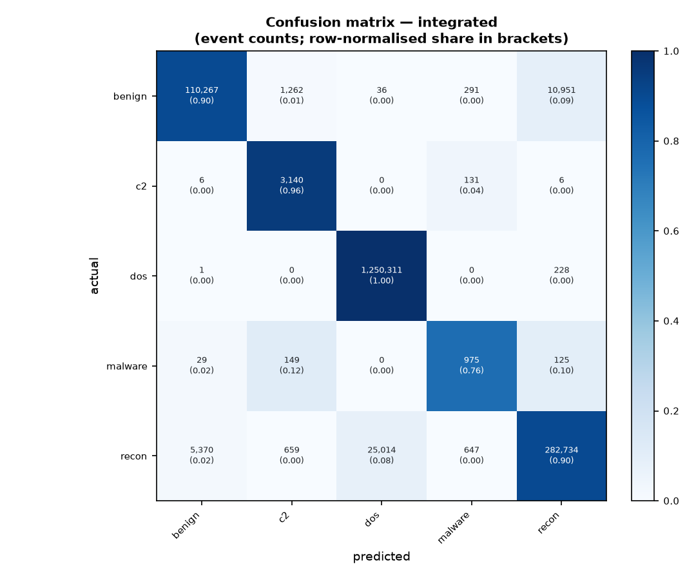
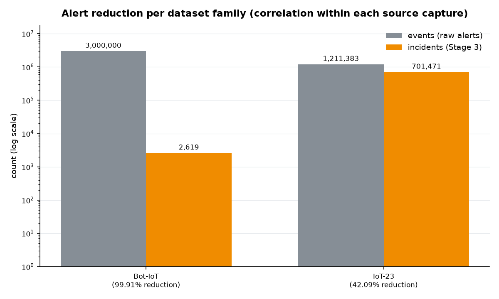
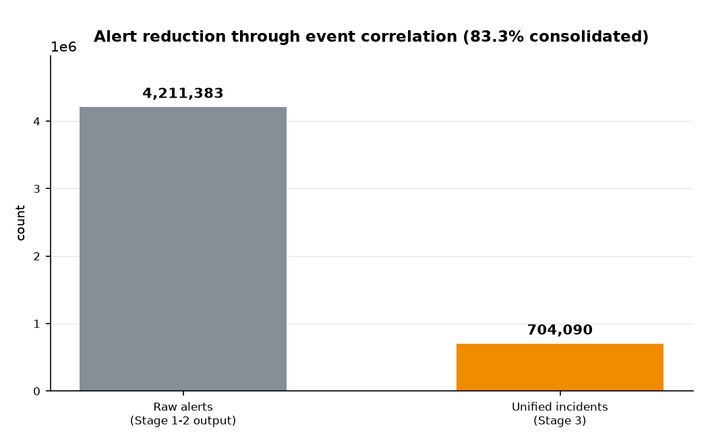
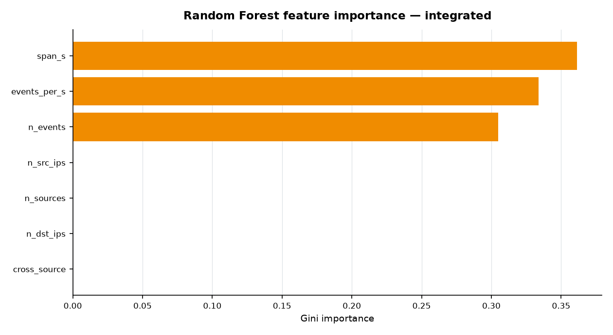

# Integrated Information Management for Cybersecurity Risk Mitigation
## Experimental Results — IoT-Enabled Smart Home Networks

*Generated 2026-10-16 09:05 UTC by `pipeline.reporting` from `results/stage5_report.json`; every number below is read from that file.*

## 1. Design

- **Fragmented (baseline):** one Random Forest per source capture (13 sources, 11 fitted forests; single-class sources predict their one class), each trained only on its own source's train events with 20 event features.
- **Integrated (proposed):** one Random Forest over Stage 3 incident features (7 features); each test incident's predicted label is propagated to its member events, which are scored against their own event labels.
- **Correlation scope:** `source` - incidents are formed within one source capture; events of different captures are never merged.
- Both conditions use the same Random Forest configuration (section on model configuration below) and the same metrics.

## 2. Held-out test set

The train/test split is grouped by Stage 3 correlation group, so the events of one incident stay on one side (0 incidents have events on both sides). Strategy: Stage 2 hash of the Stage 3 correlation group key (source, rule, src_ip, dst_ip, proto, floor(ts/window)); uncorrelatable rows hashed individually.

| | Events | Incidents |
|---|---|---|
| Corpus | 4,211,383 | 704,090 |
| Test | 1,692,332 (40.2%) | 175,489 (24.9%) |

Both conditions are scored on the **identical** 1,692,332 held-out test events.

## 3. Results (event level, held-out test events)

| Metric | Fragmented (baseline) | Integrated (proposed) | Difference (integrated − baseline) | Better |
|---|---|---|---|---|
| accuracy | 0.9995 | 0.9735 | -0.0260 | fragmented |
| precision macro | 0.9922 | 0.7950 | -0.1972 | fragmented |
| recall macro | 0.9989 | 0.9033 | -0.0956 | fragmented |
| f1 macro | 0.9955 | 0.8341 | -0.1614 | fragmented |
| fpr (lower is better) | 0.0046 | 0.1021 | +0.0975 | fragmented |
| fnr (lower is better) | 0.0001 | 0.0034 | +0.0033 | fragmented |

FPR and FNR are error rates: lower is better. Macro averages use the union of true and predicted classes.

- The integrated condition scored lower macro F1 than the baseline (integrated 0.8341 vs baseline 0.9955; worse for the integrated condition).
- The integrated condition scored lower accuracy than the baseline (integrated 0.9735 vs baseline 0.9995; worse for the integrated condition).
- The integrated condition scored higher FPR than the baseline (integrated 0.1021 vs baseline 0.0046; worse for the integrated condition).
- The integrated condition scored higher FNR than the baseline (integrated 0.0034 vs baseline 0.0001; worse for the integrated condition).

### Per-class F1

| Class | Test events (support) | F1 fragmented | F1 integrated |
|---|---|---|---|
| benign | 122,807 | 0.9968 | 0.9247 |
| c2 | 3,283 | 0.9819 | 0.7394 |
| dos | 1,250,540 | 1.0000 | 0.9900 |
| malware | 1,278 | 1.0000 | 0.5870 |
| recon | 314,424 | 0.9986 | 0.9293 |

### Integrated condition at incident level (secondary)

One row per test incident; target = the incident's majority label.

| | Accuracy | Macro F1 | FPR | FNR | Incidents |
|---|---|---|---|---|---|
| Integrated, incident level | 0.9480 | 0.7017 | 0.0330 | 0.0834 | 175,489 |

## 4. Robustness checks

| Check | Condition | Accuracy | Macro F1 | FPR | FNR | n |
|---|---|---|---|---|---|---|
| Events in incidents ≤ 10,000 events | fragmented | 0.9975 | 0.9755 | 0.0046 | 0.0010 | 363,035 |
| Events in incidents ≤ 10,000 events | integrated | 0.9435 | 0.6472 | 0.1021 | 0.0225 | 363,035 |
| Incident majority vote | fragmented | 0.9995 | 0.9504 | 0.0006 | 0.0004 | 175,489 |
| Incident majority vote | integrated | 0.9480 | 0.7017 | 0.0330 | 0.0834 | 175,489 |

The size-restricted check keeps 363,035 test events in 175,482 incidents and excludes 1,329,297 events in 7 large incidents.

The majority-vote check gives each of the 175,489 test incidents one vote: one vote per test incident; true = majority of its event labels, pred = majority of the condition's event predictions (ties: count desc, benign first, then alphabetical).

## 5. Uncertainty: incident-clustered bootstrap

1,000 replicates (seed 42) resampling the 175,489 test incidents with replacement; all events of a drawn incident are included and both conditions use the same draws. Cells show the full-sample value and the 95% percentile interval. **This is a percentile confidence interval from a clustered bootstrap, not a significance test.**

| Metric | Fragmented | Integrated | Difference (integrated − baseline) |
|---|---|---|---|
| accuracy | 0.9995 [0.9986, 0.9997] | 0.9735 [0.9098, 0.9918] | -0.0260 [-0.0895, -0.0079] |
| macro F1 | 0.9955 [0.9885, 0.9992] | 0.8341 [0.7884, 0.8684] | -0.1614 [-0.2055, -0.1280] |
| FPR | 0.0046 [0.0040, 0.0055] | 0.1021 [0.0970, 0.1076] | +0.0975 [+0.0925, +0.1027] |
| FNR | 0.0001 [0.0001, 0.0004] | 0.0034 [0.0019, 0.0101] | +0.0033 [+0.0018, +0.0097] |

## 6. Alert consolidation

Within-capture correlation grouped 4,211,383 events into 704,090 incidents, an overall alert reduction of 83.28%. The reduction differs strongly between the datasets:

| Dataset | Sources | Events | Incidents | Alert reduction |
|---|---|---|---|---|
| Bot-IoT | 3 | 3,000,000 | 2,619 | 99.91% |
| IoT-23 | 10 | 1,211,383 | 701,471 | 42.09% |
| overall | 13 | 4,211,383 | 704,090 | 83.28% |

0 incidents span more than one source; captures are independent, so no cross-source correlation is claimed.

## 7. Diagnostic ablations (not thesis conditions)

Same test events, same Random Forest configuration. The pooled model is one event model over all sources (pooling without correlation); the enriched model adds the event's incident context to the event features. They help explain the two conditions and are **not** part of the thesis comparison.

| Model | Accuracy | Macro F1 | FPR | FNR | n |
|---|---|---|---|---|---|
| pooled event model | 0.9996 | 0.9944 | 0.0039 | 0.0001 | 1,692,332 |
| enriched event model | 0.9991 | 0.9961 | 0.0116 | 0.0001 | 1,692,332 |

Train/test duplicates: 13.54% of test events have an exact event-feature vector that also occurs among train events. Metrics on the 1,463,143 novel test events only:

| Model | Accuracy | Macro F1 | FPR | FNR | n |
|---|---|---|---|---|---|
| fragmented | 0.9994 | 0.9910 | 0.0346 | 0.0002 | 1,463,143 |
| integrated | 0.9712 | 0.7140 | 0.7646 | 0.0024 | 1,463,143 |
| pooled | 0.9996 | 0.9909 | 0.0291 | 0.0001 | 1,463,143 |
| enriched | 0.9990 | 0.9880 | 0.0857 | 0.0000 | 1,463,143 |

## 8. Per-source baseline performance

Per-source macro F1 uses the union of that source's true and predicted classes, so single-class sources can score 1.0.

| Source | Accuracy | Macro F1 | FPR | Test events | Note |
|---|---|---|---|---|---|
| CTU-Honeypot-Capture-4-1 | 1.0000 | 1.0000 | 0.0000 | 131 | single-class train sample (benign): predicts it for every test event; no attack events: FNR undefined (NaN) |
| CTU-Honeypot-Capture-5-1 | 1.0000 | 1.0000 | 0.0000 | 390 | single-class train sample (benign): predicts it for every test event; no attack events: FNR undefined (NaN) |
| CTU-IoT-Malware-Capture-1-1 | 0.9979 | 0.9986 | 0.0044 | 252,274 |  |
| CTU-IoT-Malware-Capture-20-1 | 1.0000 | 1.0000 | 0.0000 | 815 |  |
| CTU-IoT-Malware-Capture-21-1 | 1.0000 | 1.0000 | 0.0000 | 1,004 |  |
| CTU-IoT-Malware-Capture-3-1 | 1.0000 | 1.0000 | 0.0000 | 38,403 |  |
| CTU-IoT-Malware-Capture-34-1 | 0.9042 | 0.4748 | 0.0974 | 1,743 |  |
| CTU-IoT-Malware-Capture-42-1 | 1.0000 | 1.0000 | 0.0000 | 1,070 | no attack events: FNR undefined (NaN) |
| CTU-IoT-Malware-Capture-44-1 | 1.0000 | 1.0000 | 0.0000 | 53 | no attack events: FNR undefined (NaN) |
| CTU-IoT-Malware-Capture-8-1 | 1.0000 | 1.0000 | 0.0000 | 2,634 |  |
| data_1 | 0.9985 | 0.8882 | 0.0026 | 143,250 |  |
| data_10 | 1.0000 | 0.8929 | 0.2143 | 498,016 |  |
| data_36 | 1.0000 | 1.0000 | 0.0000 | 752,549 |  |

## 9. Cross-validation (training data only)

- Baseline: 0.9992 ± 0.0003 macro F1 (per-source StratifiedGroupKFold(groups=incident_id); fold k pooled across sources), covering 6 sources; skipped (single-class or too few incidents per class): CTU-Honeypot-Capture-4-1, CTU-Honeypot-Capture-5-1, CTU-IoT-Malware-Capture-20-1, CTU-IoT-Malware-Capture-21-1, CTU-IoT-Malware-Capture-42-1, CTU-IoT-Malware-Capture-44-1, data_36.
- Integrated: 0.7681 ± 0.0283 macro F1 (StratifiedKFold).

The two CV figures cover different rows, units and label sets, so they are not directly comparable with each other; the held-out results above are the comparison.

## 10. Model configuration and features

| Parameter | Value |
|---|---|
| n_estimators | 300 |
| max_depth | 24 |
| min_samples_leaf | 2 |
| class_weight | balanced_subsample |
| bootstrap | True |
| random_state | 42 |
| train_budget_per_class | 60000 |
| cv_folds | 5 |

- Fragmented event features (20): `sport`, `dport`, `proto`, `app`, `duration`, `conn_state`, `missed_bytes`, `history`, `bwd_pkts`, `bwd_ip_bytes`, `bytes`, `flgs`, `state`, `stddev`, `sum`, `min`, `max`, `rate`, `srate`, `drate`
- Integrated incident features (7): `n_events`, `n_sources`, `n_src_ips`, `n_dst_ips`, `span_s`, `events_per_s`, `cross_source`
- Integrated features with zero importance (never used for a split, consistent with being constant in the training sample): `n_src_ips`, `n_sources`, `n_dst_ips`, `cross_source`

## 11. Caveats

- **DoS and DDoS share one class.** Vendor labels are mapped to a common vocabulary at ingest; DoS and DDoS ground truth both become `dos`, so no metric separates them.
- **Classes absent from the data:** `botnet`, `bruteforce`, `theft` are in the label vocabulary but no event carries them, so they are not evaluated.
- **Within-capture evaluation.** Train and test events come from the same captures, which share hosts and time context; the scores are not field performance on unseen networks.
- **Lumpy split.** The split is by incident, so the test set holds 40.2% of events but 24.9% of incidents (nominal test fraction 25%). 7 incidents with more than 10,000 events hold 1,329,297 of the test events.
- **Unequal training sets.** Both use the same per-class budget, but the baseline samples events per source while the integrated model samples incidents, so the class make-up differs:

  | Class | Fragmented train events (all sources) | Integrated train incidents |
  |---|---|---|
  | benign | 77,611 | 60,000 |
  | c2 | 11,719 | 561 |
  | dos | 134,394 | 26 |
  | malware | 4,687 | 238 |
  | recon | 180,001 | 60,000 |

- **Constant incident features.** 4 of the 7 incident features have zero importance - the model never splits on them (n_src_ips, n_sources, n_dst_ips, cross_source) - so the integrated model effectively uses n_events, span_s, events_per_s.
- **Outcome.** The integrated condition scored lower macro F1 than the baseline (integrated 0.8341 vs baseline 0.9955; worse for the integrated condition). The 95% clustered-bootstrap percentile interval of the difference is [-0.2055, -0.1280]. No claim of statistical significance is made.

---

Artefacts: `results/stage5_report.json`, `results/stage5_summary.txt`, `results/baseline_vs_integrated.csv`, `results/fragmented_event_predictions.csv`, `results/integrated_event_predictions.csv`, `results/diagnostic_event_predictions.csv`, `results/run_manifest.json`, `results/transcripts/make_report_rerun.log`, `results/transcripts/make_report_run.log`, `results/transcripts/record_run_info_run.log`, `results/transcripts/run_all.log`, `results/transcripts/run_pipeline_run.log`, `results/transcripts/stage1_run.log`, `models/rf_integrated.joblib`, `models/rf_integrated_features.csv`
